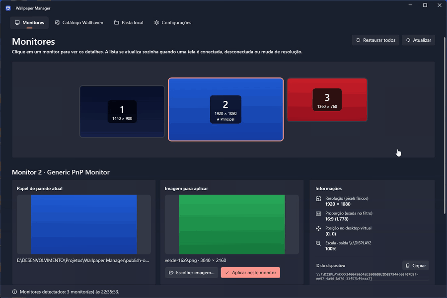
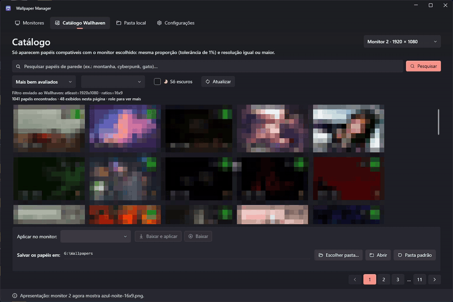
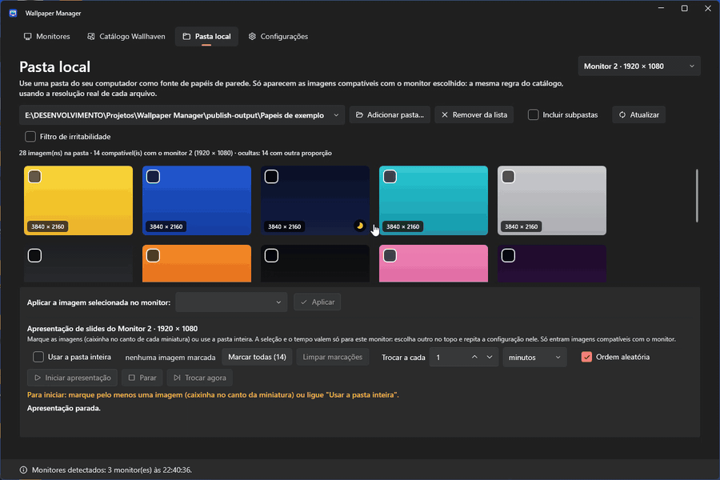

# Wallpaper Manager

> Gerenciador de papéis de parede **por monitor** para Windows 11, com catálogo online (Wallhaven), pasta local e apresentação de slides independente por tela.

---

## Por que foi criado

O Windows não permite aplicar papéis de parede diferentes em monitores de resoluções distintas de forma prática — ele mostra a mesma imagem em todas as telas, esticada ou cortada. Ferramentas de terceiros existentes ou cobram ou são abandonadas.

Este app nasceu da necessidade real de ter **três monitores** (1440×900, 1920×1080 e 1360×768) cada um com seu próprio papel de parede, pesquisado direto no Wallhaven, filtrado pela resolução correta de cada tela, com transição suave e apresentação de slides automática — sem precisar abrir um site, baixar manualmente e configurar cada monitor.

---

## Funcionalidades

| Função | Detalhe |
|---|---|
| **Por monitor** | Detecta todos os monitores conectados (PerMonitorV2); aplica e lembra o papel de parede de cada um separadamente |
| **Catálogo Wallhaven** | Barra de pesquisa por termo, filtro por várias tags (etiquetas com X; traz só papéis que têm todas) e ordenação; só exibe imagens compatíveis com o monitor selecionado |
| **Paginação numerada** | Navegue por páginas (`1 … 4 5 [6] 7 8 … 120`) e veja sempre outros papéis de parede |
| **Visualização em tela cheia** | Botão de olho (ou duplo clique) abre a imagem original em tela cheia, com ← → para navegar, "Baixar" e "Baixar e aplicar" |
| **Baixar ou baixar e aplicar** | Micro botão de download em cada miniatura, ou "Baixar" para alimentar a pasta de destino sem mexer em nenhum monitor |
| **Sem downloads repetidos** | Papéis já baixados ganham o selo "✓ Baixado" e nunca são baixados de novo |
| **Regra de compatibilidade** | Proporção (tolerância 1%) e resolução (largura e altura ≥ a do monitor) verificadas antes de exibir, antes de baixar e antes de aplicar |
| **Pasta local** | Usa uma pasta do seu PC como fonte; todas as imagens numa lista só, com rolagem infinita; respeita a mesma regra de dimensões |
| **Apresentação de slides** | Por monitor, intervalo configurável, ordem aleatória ou sequencial, seleção por imagem ou pasta inteira; desmarque qualquer imagem para tirá-la da apresentação, até com ela em andamento |
| **Transição** | Fade para preto rápido em toda troca de papel (apresentação e aplicações à mão); só a área de trabalho escurece, as janelas abertas não são cobertas |
| **Segundo plano** | Roda em segundo plano com ícone na bandeja do sistema; fechar a janela não encerra o app |
| **Inicia com o Windows** | Registra-se no logon automaticamente; ao iniciar no boot, fica só na bandeja e retoma as apresentações |
| **Instância única** | Abrir o atalho com o app já rodando traz a janela de volta em vez de abrir uma segunda cópia |
| **Chave de API** | Opcional; armazenada com DPAPI (criptografia do Windows) — nunca em texto simples |
| **Pasta de download** | Escolha onde salvar os wallpapers; o app só apaga o que ele mesmo baixou |

---

## Demonstração

### Monitores — um papel de parede para cada tela

*Escolha o monitor, veja o papel atual e reaplique o último papel. Cada tela é independente.*

### Catálogo Wallhaven — só o que cabe no monitor

*Escolha tags na lista (ou digite uma): cada uma vira uma etiqueta com X e a busca traz só papéis que têm todas. Só aparecem imagens com a proporção e a resolução do monitor escolhido.*

### Pasta local — apresentação de slides por monitor

*Desmarque qualquer imagem para tirá-la da apresentação (mesmo com ela em andamento); marque de novo para devolvê-la. Defina o intervalo, inicie e troque na hora com "Trocar agora".*

---

## Requisitos

- Windows 10 / 11 (x64)
- [.NET 10 Desktop Runtime](https://dotnet.microsoft.com/pt-br/download/dotnet/10.0) — baixe o **".NET Desktop Runtime"**, não o SDK

---

## Instalação

1. Baixe `WallpaperManager.exe` em [Releases](../../releases/latest)
2. Coloque em qualquer pasta (ex.: `%LOCALAPPDATA%\Programs\WallpaperManager\`)
3. Execute; na primeira vez ele se registra para iniciar com o Windows

> Se quiser instalar pelo código-fonte, clone o repositório e execute `instalar.cmd` na raiz — ele compila, publica e cria o atalho na área de trabalho automaticamente.

---

## Compilar do código-fonte

**Requisitos:** .NET 10 SDK, Windows

```
git clone https://github.com/Luc4sL4mou/wallpaper-manager.git
cd wallpaper-manager
instalar.cmd
```

O script cria `%LOCALAPPDATA%\Programs\WallpaperManager\WallpaperManager.exe` e um atalho na área de trabalho.

---

## Estrutura do projeto

```
src/WallpaperManager/
├── Interop/            # COM IDesktopWallpaper + NativeMethods (Shell_NotifyIcon…)
├── Models/             # AppSettings, MonitorInfo, WallpaperItem, LocalImage…
├── Services/           # MonitorService, WallpaperService, WallhavenService, DownloadService,
│                       # LocalFolderService, SlideshowPlaylist, WallpaperFader, DesktopCapture,
│                       # AutostartService, SingleInstance, CompatibilityChecker, SettingsService…
├── ViewModels/         # MainViewModel, CatalogViewModel, LocalFolderViewModel,
│                       # MonitorSlideshowViewModel, SlideshowManager, SettingsViewModel…
└── Views/              # MainWindow.xaml, TrayIcon.cs, Converters/
```

---

## Tecnologias

- **C# / .NET 10** — WPF (Windows Presentation Foundation)
- **WPF-UI 4.3.0** — tema Fluent (Mica), cartões, ícones Segoe Fluent
- **IDesktopWallpaper** (COM) — aplica wallpaper por monitor sem SystemParametersInfo
- **Wallhaven API** — catálogo público com suporte a chave privada
- **DPAPI** — criptografia da chave de API via `ProtectedData` do .NET

---

## Privacidade

O Wallpaper Manager não coleta, não envia e não vende nenhum dado para o desenvolvedor: não há telemetria, conta nem servidor próprio.

- **Fica só no seu computador:** as configurações (pastas escolhidas, monitores, apresentações, filtros) em `%LocalAppData%\WallpaperManager\settings.json` e um registro de erros local em `%LocalAppData%\WallpaperManager\logs\`.
- **Vai para o Wallhaven:** quando você usa o catálogo, o app consulta diretamente a API do Wallhaven. O Wallhaven recebe os termos e tags pesquisados, o seu endereço IP e, se você cadastrou uma, a sua chave de API. O uso desses dados segue os termos e a política de privacidade do [Wallhaven](https://wallhaven.cc).
- **Chave de API:** guardada criptografada com DPAPI (só o seu usuário do Windows consegue ler) e enviada apenas por cabeçalho HTTPS ao Wallhaven, nunca pela URL.
- **Pasta local:** as imagens das suas pastas são lidas só no seu computador e nunca são enviadas a lugar nenhum.

---

## Aviso legal

- Este projeto **não é afiliado, patrocinado nem endossado pelo Wallhaven**. "Wallhaven" é usado apenas para indicar a origem do catálogo, acessado pela [API pública](https://wallhaven.cc/help/api) dele.
- **Os papéis de parede pertencem aos seus autores.** O app não hospeda nem redistribui imagens: ele só exibe e baixa, para o seu computador, o que o Wallhaven disponibiliza. Respeite os direitos dos autores ao usar as imagens.
- **Conteúdo adulto (NSFW)** vem desligado e só pode ser ativado com uma chave de API de uma conta do Wallhaven, que exige que o titular tenha **18 anos ou mais**.
- O "Filtro de irritabilidade" e o filtro "Só escuros" apenas selecionam imagens com pouca luz branca; não são recursos médicos nem prometem efeito na saúde dos olhos.

---

## Licença

**[PolyForm Noncommercial 1.0.0](LICENSE)**: o Wallpaper Manager é gratuito e pode ser usado, estudado, modificado e compartilhado **somente para fins não comerciais**.

**É proibida qualquer forma de monetização** deste software, original ou modificado, por exemplo:

- vender o app ou cópias dele, ou cobrar para baixar, instalar, ativar ou liberar funções;
- colocar anúncios no app, numa versão modificada ou em páginas cujo objetivo seja distribuí-lo;
- oferecer assinaturas, versões "premium", pacotes pagos ou suporte pago em torno dele;
- incluí-lo em produtos, serviços ou pacotes vendidos, ou usá-lo como parte de qualquer atividade comercial.

**É permitido:** uso pessoal, estudo, pesquisa, hobby e uso por organizações sem fins lucrativos, instituições de ensino e órgãos públicos. Também é permitido compartilhar e modificar o app para esses fins, desde que junto com a licença e a linha `Required Notice` do arquivo [LICENSE](LICENSE).

Esta lista é um resumo para facilitar a leitura. O que vale juridicamente é o texto do arquivo [LICENSE](LICENSE).

> As versões publicadas até o commit `8e39baa` (incluindo as releases v1.0.0 e v1.0.1) foram distribuídas sob a licença MIT e continuam sob ela para quem as obteve. A PolyForm Noncommercial vale a partir das versões seguintes.

O executável inclui componentes de terceiros (WPF UI e os componentes que ela incorpora), todos com as licenças e avisos listados em [THIRD_PARTY_NOTICES.md](THIRD_PARTY_NOTICES.md).
