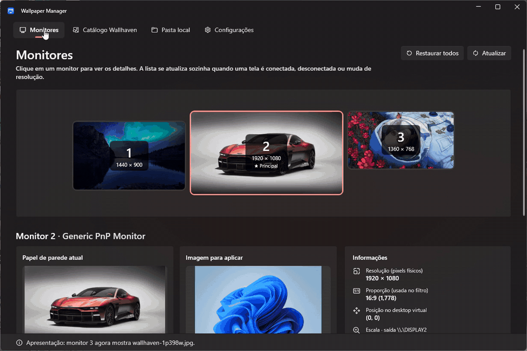
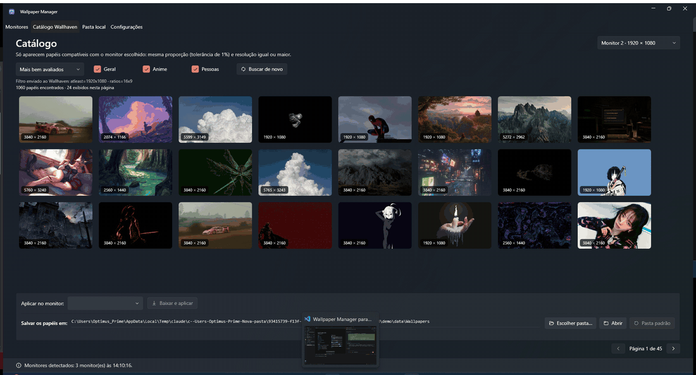
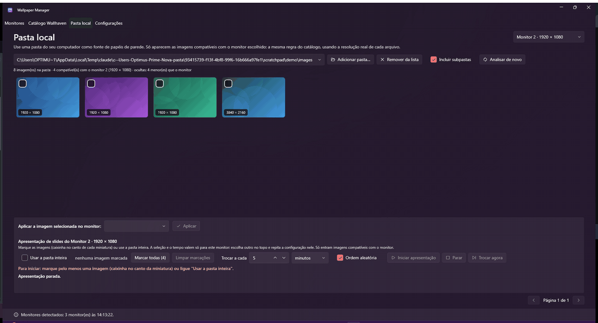

# Wallpaper Manager

> Gerenciador de papéis de parede **por monitor** para Windows 11, com catálogo online (Wallhaven), pasta local e apresentação de slides independente por tela.

---

## Por que foi criado

O Windows não permite aplicar papéis de parede diferentes em monitores de resoluções distintas de forma prática — ele mostra a mesma imagem em todas as telas, esticada ou cortada. Ferramentas de terceiros existentes ou cobram ou são abandonadas.

Este app nasceu da necessidade real de ter **três monitores** (1440×900, 1920×1080 e 1360×768) cada um com seu próprio papel de parede, pesquisado direto no Wallhaven, filtrado pela resolução correta de cada tela, com transição suave e apresentação de slides automática — sem precisar abrir um site, baixar manualmente e configurar cada monitor.

---

## Funcionalidades

| Função | Detalhe |
|---|---|
| **Por monitor** | Detecta todos os monitores conectados (PerMonitorV2); aplica e lembra o papel de parede de cada um separadamente |
| **Catálogo Wallhaven** | Barra de pesquisa por termo, categorias e ordenação; só exibe imagens compatíveis com o monitor selecionado |
| **Paginação numerada** | Navegue por páginas (`1 … 4 5 [6] 7 8 … 120`) e veja sempre outros papéis de parede |
| **Visualização em tela cheia** | Botão de olho (ou duplo clique) abre a imagem original em tela cheia, com ← → para navegar, "Baixar" e "Baixar e aplicar" |
| **Baixar ou baixar e aplicar** | Micro botão de download em cada miniatura, ou "Baixar" para alimentar a pasta de destino sem mexer em nenhum monitor |
| **Sem downloads repetidos** | Papéis já baixados ganham o selo "✓ Baixado" e nunca são baixados de novo |
| **Regra de compatibilidade** | Proporção (tolerância 1%) e resolução (largura e altura ≥ a do monitor) verificadas antes de exibir, antes de baixar e antes de aplicar |
| **Pasta local** | Usa uma pasta do seu PC como fonte; todas as imagens numa lista só, com rolagem infinita; respeita a mesma regra de dimensões |
| **Apresentação de slides** | Por monitor, intervalo configurável, ordem aleatória ou sequencial, seleção por imagem ou pasta inteira |
| **Transição suave** | Fade entre os papéis usando captura da área de trabalho (PrintWindow) — ícones continuam visíveis |
| **Segundo plano** | Roda em segundo plano com ícone na bandeja do sistema; fechar a janela não encerra o app |
| **Inicia com o Windows** | Registra-se no logon automaticamente; ao iniciar no boot, fica só na bandeja e retoma as apresentações |
| **Instância única** | Abrir o atalho com o app já rodando traz a janela de volta em vez de abrir uma segunda cópia |
| **Chave de API** | Opcional; armazenada com DPAPI (criptografia do Windows) — nunca em texto simples |
| **Pasta de download** | Escolha onde salvar os wallpapers; o app só apaga o que ele mesmo baixou |

---

## Demonstração

### Monitores — um papel de parede para cada tela

*Escolha o monitor, veja o papel atual e reaplique o último papel. Cada tela é independente.*

### Catálogo Wallhaven — só o que cabe no monitor

*Os filtros mudam a busca; só aparecem imagens com a proporção e a resolução do monitor escolhido.*

### Pasta local — apresentação de slides por monitor

*Marque imagens, defina o intervalo, inicie a apresentação e troque na hora com "Trocar agora".*

---

## Requisitos

- Windows 10 / 11 (x64)
- [.NET 10 Desktop Runtime](https://dotnet.microsoft.com/pt-br/download/dotnet/10.0) — baixe o **".NET Desktop Runtime"**, não o SDK

---

## Instalação

1. Baixe `WallpaperManager.exe` em [Releases](../../releases/latest)
2. Coloque em qualquer pasta (ex.: `%LOCALAPPDATA%\Programs\WallpaperManager\`)
3. Execute; na primeira vez ele se registra para iniciar com o Windows

> Se quiser instalar pelo código-fonte, clone o repositório e execute `instalar.cmd` na raiz — ele compila, publica e cria o atalho na área de trabalho automaticamente.

---

## Compilar do código-fonte

**Requisitos:** .NET 10 SDK, Windows

```
git clone https://github.com/Luc4sL4mou/wallpaper-manager.git
cd wallpaper-manager
instalar.cmd
```

O script cria `%LOCALAPPDATA%\Programs\WallpaperManager\WallpaperManager.exe` e um atalho na área de trabalho.

---

## Estrutura do projeto

```
src/WallpaperManager/
├── Interop/            # COM IDesktopWallpaper + NativeMethods (Shell_NotifyIcon, PrintWindow…)
├── Models/             # AppSettings, MonitorInfo, WallpaperItem, LocalImage…
├── Services/           # MonitorService, WallpaperService, WallhavenService, DownloadService,
│                       # LocalFolderService, SlideshowPlaylist, WallpaperFader, DesktopCapture,
│                       # AutostartService, SingleInstance, CompatibilityChecker, SettingsService…
├── ViewModels/         # MainViewModel, CatalogViewModel, LocalFolderViewModel,
│                       # MonitorSlideshowViewModel, SlideshowManager, SettingsViewModel…
└── Views/              # MainWindow.xaml, TrayIcon.cs, Converters/
```

---

## Tecnologias

- **C# / .NET 10** — WPF (Windows Presentation Foundation)
- **WPF-UI 4.3.0** — tema Fluent (Mica), cartões, ícones Segoe Fluent
- **IDesktopWallpaper** (COM) — aplica wallpaper por monitor sem SystemParametersInfo
- **Wallhaven API** — catálogo público com suporte a chave privada
- **DPAPI** — criptografia da chave de API via `ProtectedData` do .NET

---

## Licença

MIT — use, modifique e distribua à vontade. Veja o arquivo [LICENSE](LICENSE).
